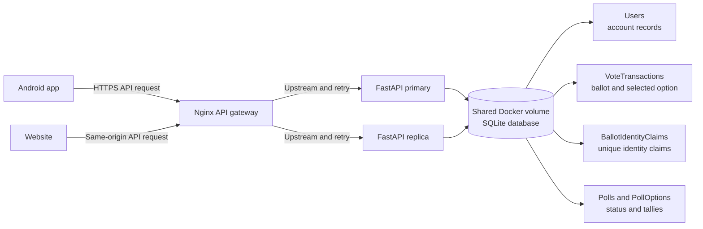
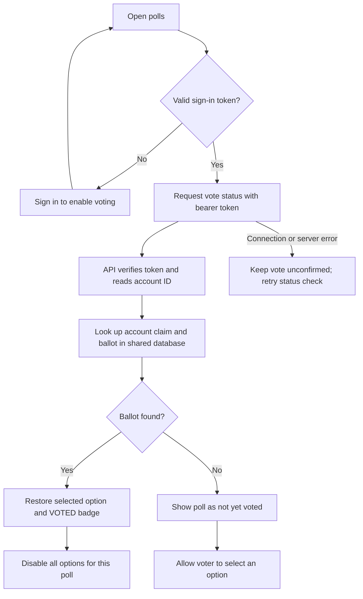
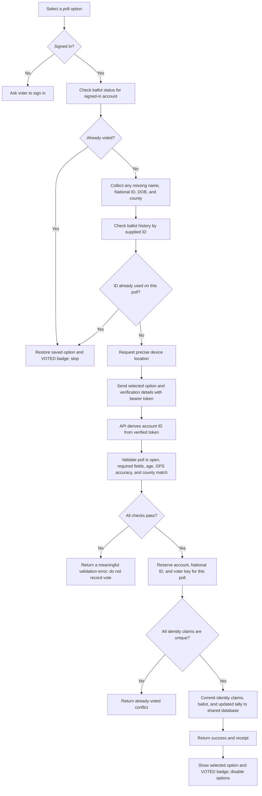
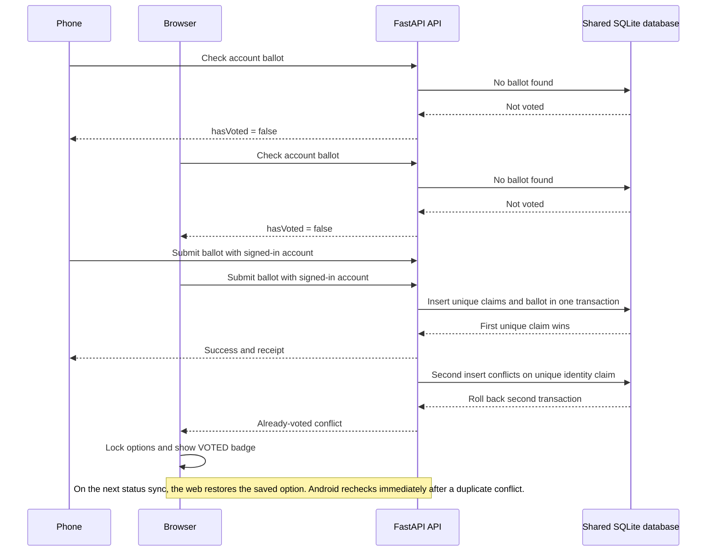
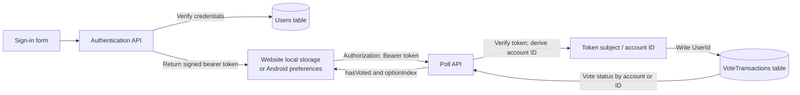

# IcapsQ Voting Workflows

These diagrams describe the current poll voting implementation shared by the Android app and website. They cover sign-in, ballot recovery, verification, database recording, duplicate protection, and the voted display.

## 1. Request routing and shared data

The website sends same-origin API requests through Nginx. The Android release uses the public API gateway. Nginx can route to either FastAPI container; both containers mount the same Docker volume containing SQLite.

## 2. Sign-in and restoring the VOTED badge

An account-linked vote can be restored without an ID stored on the phone. The client sends its bearer token; the API reads the account ID (`sub`) from the verified token and looks up that account's ballot for the poll.

If no account ballot exists, a first-time vote still requires voter details. If a historical ballot was stored only by National ID and is not linked to the account, the API can find it only when that same ID is supplied for the identity check.

On Android, a locally cached account vote can preserve the badge during a temporary status outage. That cache is account-scoped and is only a display fallback; the database remains authoritative. The website checks the API when loading and again before submitting.

## 3. Casting a first vote

The app and website perform the same server checks. Their screens gather the details at slightly different times, but the API is the final authority for eligibility, county match, and duplicate prevention.

## 4. Two devices submit at nearly the same time

A client-side status check is helpful for the interface, but it cannot prevent a race by itself. The database's unique claim key is the final guard when simultaneous requests arrive.

Claims are scoped to ballot type and poll ID, then identity type and identity value. Poll submissions reserve the authenticated account ID, National ID, and voter key. A conflict rolls back the second submission, so it does not increment the tally. Android immediately fetches the committed vote after a duplicate conflict; the web locks the poll as VOTED and restores the choice during its next account-status sync.

## 5. What persists where

The login token is stored on the client so the user stays signed in. The ballot itself is stored on the server in the shared database and linked to the authenticated account. The app's local voted cache helps restore the interface during an outage; it is not the authoritative record.

## Key behavior

- One account, National ID, or voter key can claim only one ballot per poll.
- A submitted ballot is immutable; refresh, sign-out, another device, or reinstall does not clear the server record.
- A signed-in account with a recorded ballot can recover its selected option and VOTED badge without a locally saved ID.
- First-time voting still requires valid voter details and a precise location that matches the selected county.
- If the API cannot confirm ballot status, the client should not submit until it can check again.
